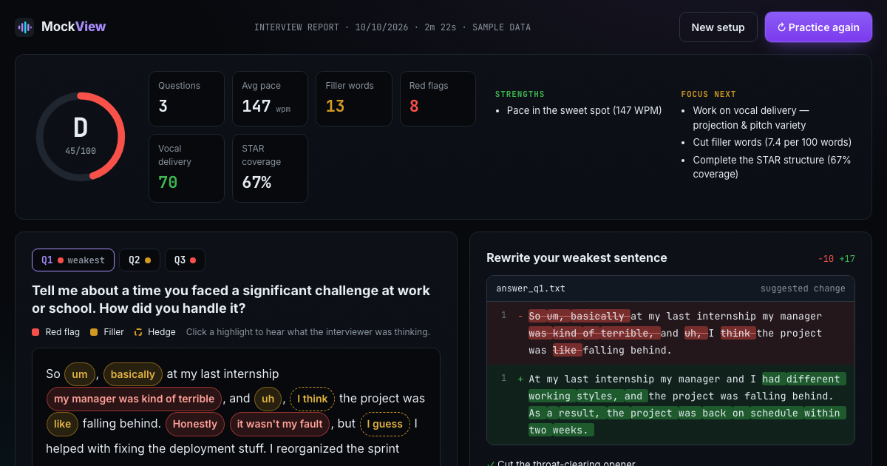
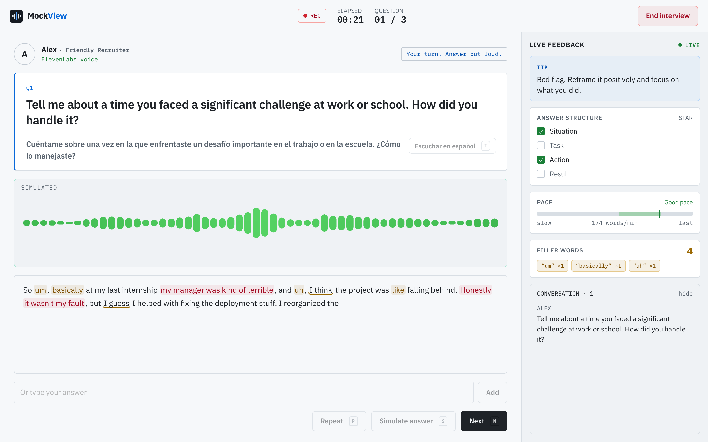
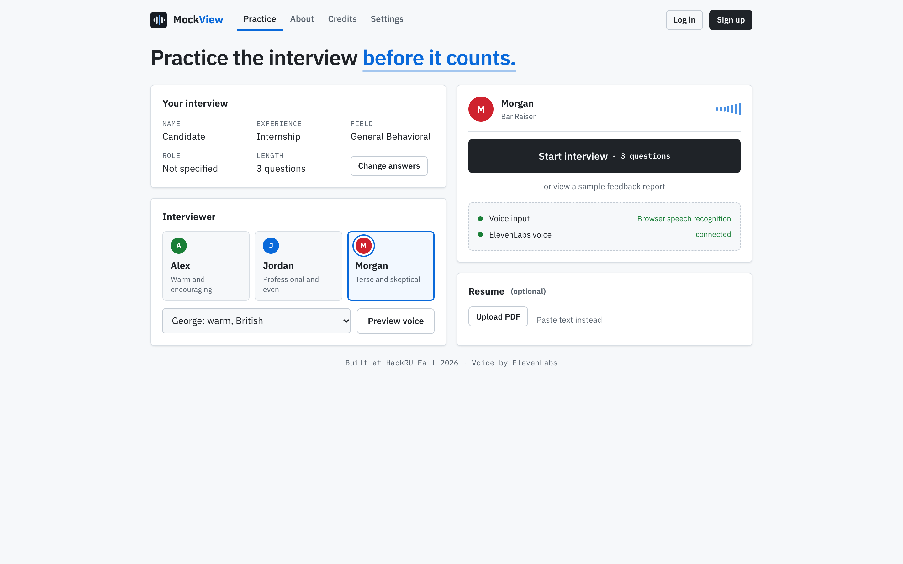

# MockView 🎙️

Behavioral interview practice you do out loud. An ElevenLabs-voiced interviewer asks the questions, a side panel grades you while you talk, and afterwards you get a report that rewrites your weakest sentence and plays it back the way it should sound.

Built at HackRU Fall 2026 (Rutgers). Education track. Entered for Best Newbie Hack and Use of ElevenLabs.

**Live:** https://mockview-ruddy.vercel.app · **Sample report:** https://mockview-ruddy.vercel.app/#sample



| Interview | Practice page |
|---|---|
|  |  |

## What it does

- **Interviewer:** three personas (friendly recruiter, hiring manager, bar raiser), four ElevenLabs voices. The recruiter says "mm-hmm", the hiring manager asks follow-ups on vague answers, the bar raiser cuts you off after 90 seconds.
- **Reacts to what you said:** a quantified STAR answer gets credit, a missing result gets called out, an empty answer never gets praise. Silence gets "Sorry, what was that?", and enough of it ends the session.
- **Live panel:** coaching tip, STAR checklist, pace bar (115 to 175 wpm is the target), filler-word counter. Everything else waits for the report.
- **Report:** transcript with red-flag and filler highlights (click one for the interviewer's inner monologue), a diff that rewrites your weakest sentence, "Hear ideal delivery" in the same voice, vocal analysis (volume, pitch variety, steadiness, pauses), your own recording, and a transcript download. Sentences unrelated to the question get crossed out instead of polished.
- **Levels and fields:** Beginner (basic warm-up questions, lighter grading), Internship, New grad, Experienced. 14 job fields. Upload a resume and some questions come from your own projects.
- **Sessions:** fixed number of questions, timed, or endless.
- **Accessibility:** larger text, high contrast, reduced motion, interviewer captions, screen-reader announcements, keyboard shortcuts (N next, R repeat, T translation, S simulate).
- **Question translation:** Spanish, Chinese, Hindi, Korean, Portuguese. The translation shows under the English question and the same voice reads it aloud; you still answer in English.
- **Accounts:** email + password, settings sync across devices. Optional.
- **Typing:** if the mic isn't an option, type the answer instead.

## How ElevenLabs is used

1. **Text to Speech** for every interviewer line (`POST /v1/text-to-speech/{voice_id}`). Each persona's pace and expressiveness map to `speed`, `stability` and `style`, so they actually sound different. `<break time="0.6s"/>` tags add pauses before questions.
2. **Models:** `eleven_multilingual_v2` by default, `eleven_flash_v2_5` as the fast option in Settings. Ideal-delivery playback always uses Multilingual v2. The same voice reads question translations in five languages.
3. **Prefetching:** the next question's audio is fetched while the current one plays, and clips are cached per sentence.
4. **Real-time Speech to Text:** browsers without working built-in recognition (Brave, Firefox) stream the mic to Scribe (`scribe_v2_realtime`) over a WebSocket, opened with a single-use token from `GET /api/stt`. Words show up as you speak. If that connection fails, it falls back to pause-to-pause clips sent to `POST /v1/speech-to-text`; clips with no detected speech are never sent.
5. The API key never reaches the browser. All calls go through [`server/elevenlabs.js`](server/elevenlabs.js), with a same-origin check and per-IP rate limit. If ElevenLabs is down, the browser's own voice takes over.

## Stack

- React 18 + Vite, hand-written CSS, light and dark themes
- Web Speech API for live transcripts in Chrome, Edge and Safari
- Web Audio API for the waveform and voice analysis (autocorrelation pitch detection, RMS loudness, adaptive noise floor)
- Grading is a rules engine in the browser ([`src/lib/analysis.js`](src/lib/analysis.js)): regex dictionaries for fillers, hedges and 13 red-flag types, STAR detection, rule-based rewrites, LCS word diff. Instant, and every point traces back to a phrase.
- Vercel for hosting and three serverless functions ([`api/tts.js`](api/tts.js), [`api/stt.js`](api/stt.js), [`api/auth.js`](api/auth.js))
- Accounts in a private Vercel Blob store keyed by a hash of the email, scrypt password hashes, HMAC-signed HttpOnly session cookie

## Run it locally

Needs Node 18+ and an [ElevenLabs API key](https://elevenlabs.io/app/settings/api-keys).

```bash
git clone https://github.com/sttstevenyao/mockview.git
cd mockview
npm install
cp .env.example .env    # put your key in ELEVENLABS_API_KEY
npm run dev             # http://localhost:5173
```

- `/#sample` opens a sample report.
- **S** during an interview streams a scripted answer, handy in a loud room.

Accounts need two more env vars. After creating the Blob store (below), run `vercel env pull .env.local` and add an `AUTH_SECRET` line to `.env.local`.

### Deploy

```bash
npm i -g vercel
vercel
vercel env add ELEVENLABS_API_KEY
vercel blob create-store mockview-accounts --access private
openssl rand -hex 32 | vercel env add AUTH_SECRET production
vercel --prod
```

## Layout

```
api/          tts.js, stt.js, auth.js         Vercel functions
server/       elevenlabs.js, auth.js, guard.js  shared by the functions and the dev server
src/
  App.jsx                                   page flow and tabs
  components/
    Intro.jsx                               opening animation
    Onboarding.jsx, EditAnswers.jsx         setup questions
    AuthForm.jsx                            sign up / log in
    Setup.jsx, ResumePanel.jsx              practice page
    Interview.jsx, LiveSidebar.jsx          interview screen
    Feedback.jsx                            report
    About.jsx, Credits.jsx, Settings.jsx
  lib/
    analysis.js                             grading, rewrites, diff
    reactions.js                            interviewer reactions, silence prompts
    transcriber.js                          Web Speech + Scribe (real-time and clips)
    voiceAnalysis.js                        pitch, loudness, pauses
    tts.js, audio.js, accounts.js, settings.js, resume.js
  data/
    questions.js                            question banks, personas, sample data
    translations.js                         every question in five languages
showcase/                                   files for the ElevenLabs Showcase PR
```

## Team

| | |
|---|---|
| Zexing Yao | Project lead |
| Kevin Wang | UI/UX design |
| Daniel Kim | Programming |

First hackathon for all three of us.

## ElevenLabs Showcase

Open source (MIT). [`showcase/`](showcase) mirrors the layout of [elevenlabs/showcase](https://github.com/elevenlabs/showcase):

```
showcase/authors/<name>.yml                    -> authors/
showcase/projects/mockview.mdx                 -> projects/
showcase/apps/www/public/images/mockview.png   -> apps/www/public/images/
```

## License

[MIT](LICENSE). © 2026 Zexing Yao, Kevin Wang, Daniel Kim
